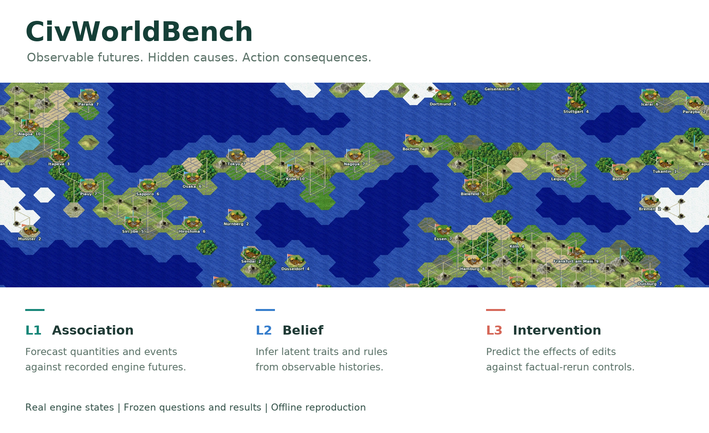

[Project Page](https://leon-francis.github.io/CivWorldBench/) | [Paper](https://leon-francis.github.io/CivWorldBench/CivWorldBench.pdf)

# CivWorldBench

**Evaluating Language World Models in Structured Multi-Agent Sandbox Worlds**

Dataset: **In preparation**



CivWorldBench evaluates forecasting, hidden-state inference, and intervention
prediction in structured multi-agent Freeciv worlds. This repository releases
the paper's code, task definitions, evaluation protocol, and engine modifications.
The paper and Project Page present the reported results.

## What We Learn

- **Forecasting strength has a structure.** Similar association scores can mask
  different hidden-state and intervention abilities.
- **Direction is not magnitude.** Intervention predictions can identify the sign
  of a change while missing its size; the benchmark measures both.
- **An answer can hide a faulty process.** Aligned Table and Code reasoning expose
  intermediate states that can be checked against engine evidence.
- **Advice depends on the situation.** Recorded success and failure cases show
  how an action can help or harm; a selected case does not establish a universal gain.

## Install and Check the Code

Use Linux and Python 3.12 for the analysis environment:

```sh
python -m venv .venv
. .venv/bin/activate
python -m pip install -r requirements.txt
python -m unittest discover -s tools -p 'test_code_release.py'
python bench/score_v2.py --help
```

These checks use synthetic values and do not download data, call model APIs, or
start the game engine. Model inference and engine collection have additional
dependencies and compute requirements; see the
[engine build instructions](freeciv-sandbox/sandboxes/freeciv/docker/README.md).
API drivers read credentials from environment variables.

## Repository Layout

| Path | Contents |
| --- | --- |
| `bench/` | Task construction, rendering, inference, parsing, scoring, aligned reasoning, and agent-play code |
| `bench/v2/` | Variable normalization constants, mechanism definitions, and engine rulesets |
| `bench/measure/out/section5/swfi_v1/spec.json` | The frozen SWFI aggregation definition and reference endpoints |
| `paper/` | Source programs for the paper's analyses, tables, and figures |
| `bundle/` | Observation, saved-state parsing, and rendering modules |
| `freeciv-sandbox/` | Collection code, Freeciv 3.1.6 patches, and engine build instructions |
| `tools/` | Code checks and analysis utilities |
| `website/` | Project Page source and approved presentation assets |

## Data Availability and Reproduction

Dataset: **In preparation**. Questions, targets, model responses, scored records,
aligned reasoning records, saved games, sample selections, and data archives are
not distributed in this code release. There is no dataset download endpoint.

The analysis programs are available for inspection, but reproducing the paper's
numerical results requires the corresponding data and calibration artifacts.
`tools/download_data.py`, `tools/unpack.py`, and `tools/reproduce.py` report this
requirement before performing work when the release data are unavailable.
The code checks above are not a numerical reproduction of the paper.

For the expected local input layout, task fields, calibration requirements, and
score-output precautions, see [the evaluation protocol](docs/PROTOCOL.md) and
[reproduction requirements](docs/REPRODUCIBILITY.md). Never include `truth` or
other evaluation metadata in a model's input context.

## Citation

Use [CITATION.cff](CITATION.cff) or [CITATION.bib](CITATION.bib) to cite CivWorldBench.
The [Paper](https://leon-francis.github.io/CivWorldBench/CivWorldBench.pdf) contains
the full methods and results.

## License

Original code and engine modifications are licensed under **GPL-2.0-or-later**.
Third-party materials retain their original terms. See [LICENSE](LICENSE) and
[NOTICE.md](NOTICE.md).
