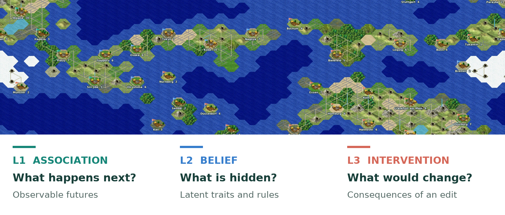
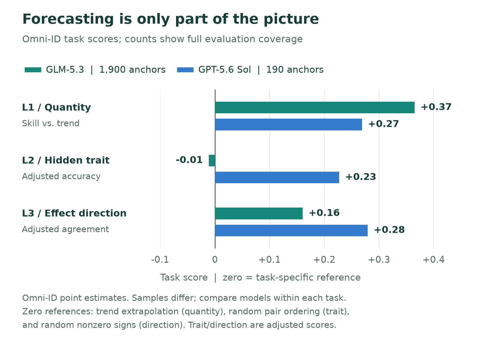
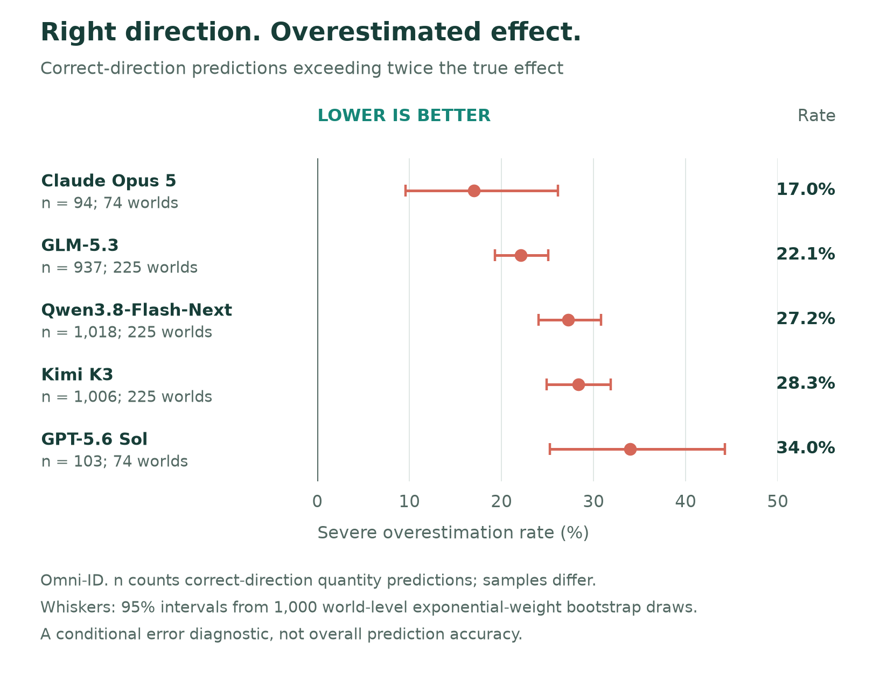
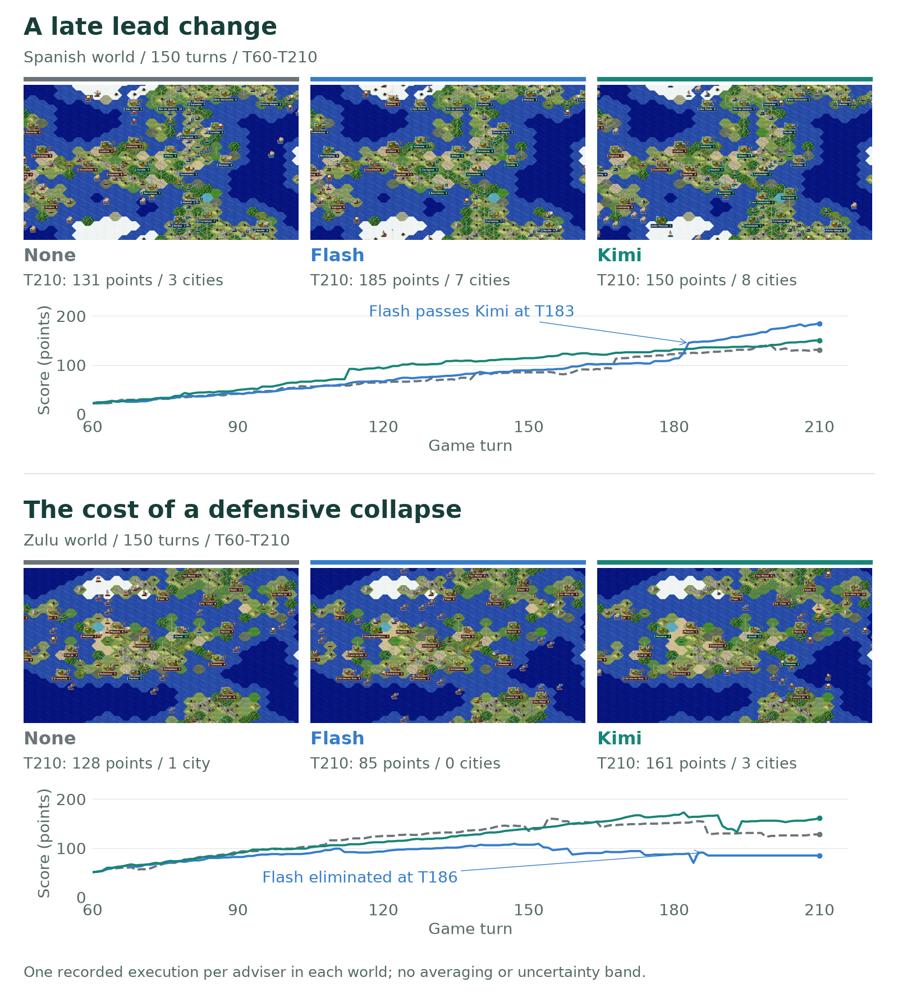

<h1 align="center">CivWorldBench</h1>

<p align="center"><strong>Evaluating Language World Models in Structured Multi-Agent Sandbox Worlds</strong></p>

<p align="center">
  <a href="https://leon-francis.github.io/CivWorldBench/"></a>
  <a href="https://leon-francis.github.io/CivWorldBench/CivWorldBench.pdf"></a>
  <a href="https://leon-francis.github.io/CivWorldBench/#cases"></a>
  
</p>

<p align="center">
  Ang Li, Haofei Yu, Zhengwei Tao, Liang Chen, Kuan Li,<br>
  Miaomiao Li, Chenran Cai, Bin Liang, Jiaxuan You, Kam-Fai Wong
</p>

> **Can a model forecast a world without understanding what changes it?**

CivWorldBench evaluates language world models in **Freeciv**, a turn-based,
multi-agent strategy game. Models predict observable futures, infer hidden traits
and rules, and estimate the consequences of interventions. Their answers are
checked against engine evidence.

<p align="center"><strong>475 worlds &nbsp; / &nbsp; 1,900 decision points &nbsp; / &nbsp; 11 models &nbsp; / &nbsp; 3 evaluation levels</strong></p>

[](https://leon-francis.github.io/CivWorldBench/#method)

<p align="center"><a href="#benchmark">Benchmark</a> &middot; <a href="#key-findings">Key Findings</a> &middot; <a href="#in-the-world">In the World</a> &middot; <a href="#quick-start">Quick Start</a> &middot; <a href="#citation">Citation</a></p>

## Benchmark

The same world supports three complementary tests:

| Level | Example question | Engine evidence |
| :--- | :--- | :--- |
| **L1 / Association** | How many military units will this civilization have in 60 turns? | Recorded future states |
| **L2 / Belief** | Which civilization is more aggressive? | Hidden engine parameters |
| **L3 / Intervention** | If civilization A gains **The Republic**, what is its score in 60 turns? | Paired rollouts with and without the edit |

Evaluation spans **Omni-ID**, **Ego-ID**, and **Omni-OOD**, varying observation
scope and world conditions. The panel covers 11 models; coverage differs by
model, with some evaluated on a 190-point subset of the 1,900 decision points.
See the [evaluation protocol](docs/PROTOCOL.md) and the
[interactive results table](https://leon-francis.github.io/CivWorldBench/#results)
for task definitions, references, and coverage.

## Key Findings

### 1. Forecasting strength does not transfer uniformly

In Omni-ID, GLM-5.3 leads Sol on quantity forecasting, while Sol is stronger at hidden-trait
inference and intervention direction. **Evaluate the structure of capability,
not only a single forecasting score.**



### 2. The right direction can hide the wrong magnitude

Even among correct-direction predictions, models often estimate an effect at
more than **twice its realized magnitude**. The plot below measures this error,
so **lower is better**. Action-conditioned forecasts need magnitude calibration
as well as sign accuracy.



This is a conditional diagnostic of nonzero quantity predictions on active
intervention cells, not overall accuracy. Each denominator counts predictions
with the correct direction. Intervals use 1,000 world-level exponential-weight
bootstrap draws; model samples differ.

### 3. A good answer can hide a faulty process

Aligned **Table** and **Code** reasoning expose intermediate forecasts that can
be checked against engine states. An answer that beats the trend reference can
coexist with intermediate forecasts that do not. This makes process-level
evaluation a useful complement to final-answer scores.

[Explore the process diagnostics on the Project Page.](https://leon-francis.github.io/CivWorldBench/#findings)

## In the World

**Does advice help an acting agent over 150 turns?** Two recorded worlds compare
**None**, **Flash**, and **Kimi**, starting at T60 and continuing to T210.

[](https://leon-francis.github.io/CivWorldBench/#cases)

- **A late lead change.** In the Spanish world, Kimi leads at T180, but Flash
  overtakes it at T183 and finishes at 185 points, versus Kimi's 150 and None's
  131. A short horizon can miss a later reversal.
- **The cost of a defensive collapse.** In the Zulu world, Flash is eliminated
  at T186. Kimi retains three cities at T210 and None retains one. All three
  trajectories suffer losses: the contrast concerns the timing and extent of
  collapse, not uninterrupted success.

These are **selected cases with one recorded execution per adviser in each
world**, not estimates of a universal improvement. Maps show full-information
recorded states; they do not represent the acting agent's observation scope.
Map colors identify civilizations, while curve colors identify advisers.

**[Open the interactive cases](https://leon-francis.github.io/CivWorldBench/#cases)**
to compare advisers, inspect individual turns, and follow the recorded advice.

## Quick Start

This repository contains the paper's **code, task definitions, evaluation
protocol, engine modifications, and Project Page**. Benchmark data are
**in preparation**.

Use Linux and Python 3.12:

```sh
git clone https://github.com/Leon-Francis/CivWorldBench.git
cd CivWorldBench
python -m venv .venv
. .venv/bin/activate
python -m pip install -r requirements.txt
python -m unittest discover -s tools -p 'test_code_release.py'
python bench/score_v2.py --help
```

These checks use synthetic values and do not download data, call model APIs, or
start the game engine. Model inference and engine collection have additional
dependencies and compute requirements; see the
[engine build instructions](freeciv-sandbox/sandboxes/freeciv/docker/README.md).
API drivers read credentials from environment variables.

### Code Guide

| Path | Start here for |
| :--- | :--- |
| [`bench/`](bench/) | Task construction, rendering, inference, parsing, scoring, aligned reasoning, and agent play |
| [`bench/v2/`](bench/v2/) | Variable normalization constants, mechanism definitions, and engine rulesets |
| [`SWFI specification`](bench/measure/out/section5/swfi_v1/spec.json) | The frozen aggregation definition and reference endpoints |
| [`paper/`](paper/) | Analysis programs for the paper's tables and figures |
| [`bundle/`](bundle/) | Observation, saved-state parsing, and rendering modules |
| [`freeciv-sandbox/`](freeciv-sandbox/) | Collection code, Freeciv 3.1.6 patches, and engine build instructions |
| [`tools/`](tools/) | Code checks and analysis utilities |
| [`website/`](website/) | Project Page source and presentation assets |

### Data Availability and Reproduction

**Dataset: In preparation.** Questions, targets, model responses, scored records,
aligned reasoning records, saved games, sample selections, and data archives are
not distributed in this code release. There is no dataset download endpoint.

Reproducing the paper's numerical results requires the corresponding data and
calibration artifacts. `tools/download_data.py`, `tools/unpack.py`, and
`tools/reproduce.py` report this requirement before performing work when the
release data are unavailable. The code checks above are not a numerical
reproduction of the paper.

See [the evaluation protocol](docs/PROTOCOL.md) and
[reproduction requirements](docs/REPRODUCIBILITY.md) for the expected inputs,
task fields, and calibration requirements. Never include `truth` or other
evaluation metadata in a model's input context.

## Citation

```bibtex
@misc{civworldbench2026,
  title = {{CivWorldBench: Evaluating Language World Models in Structured Multi-Agent Sandbox Worlds}},
  author = {Li, Ang and Yu, Haofei and Tao, Zhengwei and Chen, Liang and Li, Kuan and Li, Miaomiao and Cai, Chenran and Liang, Bin and You, Jiaxuan and Wong, Kam-Fai},
  year = {2026},
  url = {https://leon-francis.github.io/CivWorldBench/CivWorldBench.pdf}
}
```

Machine-readable citation: [CITATION.cff](CITATION.cff) | [CITATION.bib](CITATION.bib).

## License and Acknowledgments

Original code and engine modifications are licensed under **GPL-2.0-or-later**.
Map artwork derives from Freeciv's Hexemplio and Amplio assets and retains its
upstream license; displayed scientific summaries are **CC-BY-4.0**. See
[LICENSE](LICENSE), [NOTICE.md](NOTICE.md), and the
[artwork credits and provenance](website/public/media/ATTRIBUTION.md).
